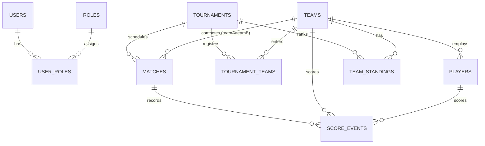

# Team Score Tracker - Backend Application

A production-quality, enterprise-grade **Team Score Tracker Backend** built with **Java 21** and **Spring Boot 3.3.4**. This system manages multi-sport tournaments, team and player rosters, match scheduling, live scorekeeping with real-time WebSocket & Server-Sent Events (SSE) broadcasting, automated tournament standings calculation, and comprehensive analytics.

---

## Table of Contents

- [1. Architecture Overview](#1-architecture-overview)
- [2. Technology Stack](#2-technology-stack)
- [3. Key Features](#3-key-features)
- [4. Database Design & Schema](#4-database-design--schema)
- [5. Initial Database State](#5-initial-database-state)
- [6. REST API Documentation](#6-rest-api-documentation)
- [7. Real-Time Scoring (WebSocket & SSE)](#7-real-time-scoring-websocket--sse)
- [8. Standings & Scoring Algorithm](#8-standings--scoring-algorithm)
- [9. Setup & Execution Instructions](#9-setup--execution-instructions)
- [10. Docker & Production Deployment](#10-docker--production-deployment)
- [11. Testing & Quality Assurance](#11-testing--quality-assurance)

---

## 1. Architecture Overview

The backend is built following a clean, modular, layered architecture:

```
backend/src/main/java/com/scoretracker/
├── config/              # Security, Web, WebSocket, and role initialization
├── controller/          # REST API endpoints (Auth, Team, Player, Tournament, Match, Score, Standing, Dashboard, User)
├── dto/                 # Request & Response Data Transfer Objects (No JPA entity exposure)
│   ├── auth/
│   ├── common/
│   ├── dashboard/
│   ├── match/
│   ├── player/
│   ├── score/
│   ├── standing/
│   ├── team/
│   └── tournament/
├── entity/              # JPA Entities with explicit constructors, getters, and setters (No Lombok)
├── enums/               # Domain enumerations (MatchStatus, SportType, TournamentFormat, etc.)
├── exception/           # Global exception handling, RFC-7807 inspired error details
├── mapper/              # Mappers between JPA Entities and DTOs
├── repository/          # Spring Data JPA repositories with custom JPQL queries
├── security/            # JWT authentication filter, token provider, user principal
└── service/             # Business logic interfaces & implementation classes
    └── impl/
```

### Clean Code Principles:
- **Zero Lombok Dependency**: All entity constructors, accessors, and mutators are explicitly written in clean modern Java.
- **Strict DTO Isolation**: Entities are never exposed directly through controllers.
- **Layered Validation**: Validation annotations on DTOs, custom business validations in services, and DB-level unique constraints.

---

## 2. Technology Stack

| Layer / Component | Technology | Version / Details |
|---|---|---|
| **Runtime Environment** | Java | **Java 21 LTS** |
| **Framework** | Spring Boot | **3.3.4** |
| **Security & Auth** | Spring Security + JJWT | **JJWT 0.12.6** (HMAC-SHA256, Stateless Bearer Tokens) |
| **Persistence** | Spring Data JPA / Hibernate 6 | Relational mappings, transactions, and indexing |
| **Real-time Engine** | Spring WebSocket + STOMP + SSE | Real-time score events via `/topic/match/{id}` and `/api/matches/{id}/live-sse` |
| **Database** | MySQL 8.0 | InnoDB, Foreign Key constraints, UTF-8 |
| **Build Tool** | Apache Maven | 3.9+ |
| **Containerization** | Docker & Docker Compose | Multi-stage build with Eclipse Temurin 21 Alpine |

---

## 3. Key Features

### Authentication & Authorization
- User signup, login, JWT token issuance with 24-hour expiration.
- Password hashing using BCrypt.
- Role-Based Access Control (**ADMIN**, **ORGANIZER**, **USER**).
- User profile updates and password change endpoints.

### Team & Player Management
- Full CRUD operations with soft/hard deletion rules.
- Team logos, captains, descriptions, status management.
- Player rosters per team with **strict duplicate jersey number prevention**.
- Team and player statistics (matches played, win rate, goals/points scored, etc.).

### Tournament Management
- Supports multiple sports: `FOOTBALL`, `BASKETBALL`, `VOLLEYBALL`, `CRICKET`, `CUSTOM`.
- Formats: `LEAGUE`, `ROUND_ROBIN`, `KNOCKOUT`.
- Automated fixture generation:
  - **Round Robin / League**: Circle method round scheduling distributing matches evenly across tournament dates.
  - **Knockout**: Bracket pairing generator (e.g., Quarterfinals, Semifinals, Finals).
- Team registration with capacity checks and seed assignments.

### Match & Live Score Tracker
- Prevents teams from playing against themselves.
- Start match (`UPCOMING` -> `LIVE`), complete match, cancel match.
- Live score update engine:
  - Add points per sport rules (e.g., Football goals, Basketball 1/2/3 pointers, Volleyball points, custom points).
  - Subtract/revert points with authorization.
  - Real-time broadcasts over WebSocket (`/topic/match/{id}`) and Server-Sent Events (SSE).
  - Score event timeline logging with minute/period and scorer details.
  - Automatic winner calculation on match completion.
  - Automatic tournament standings recalculation.

### Standings & Leaderboard
- Real-time league table computation:
  - Matches Played ($P$), Wins ($W$), Draws ($D$), Losses ($L$).
  - Points Scored ($GF$), Points Conceded ($GA$), Score Difference ($GD$).
  - Configurable tournament points (Win = 3, Draw = 1, Loss = 0).
- Automatic sorting order:
  1. Tournament Points (descending)
  2. Score Difference (descending)
  3. Points Scored (descending)
  4. Team Name (alphabetical)

### Dynamic Dashboard & Analytics
- Dynamic statistics directly from database queries:
  - Total Teams, Players, Tournaments, Matches (Completed, Upcoming, Live).
  - Top performing teams sorted by win rate and victories.
  - Team performance comparison chart data (Points Scored vs Conceded).
  - Sport distribution and match status breakdown.

---

## 4. Database Design & Schema



### Table Definitions:
1. `roles`: Role definitions (`ROLE_ADMIN`, `ROLE_ORGANIZER`, `ROLE_USER`).
2. `users`: User credentials, email, password hash, and metadata.
3. `user_roles`: Many-to-many join table between users and roles.
4. `teams`: Team profile, name, logo URL, captain, status.
5. `players`: Player records with `uk_team_jersey` constraint `(team_id, jersey_number)`.
6. `tournaments`: Tournament configurations, sport types, scoring rules.
7. `tournament_teams`: Registered teams for each tournament with seeds.
8. `matches`: Scheduled, live, and completed matches between two distinct teams.
9. `score_events`: Granular point-by-point history for live matches.
10. `team_standings`: Cached and calculated league tables.
11. `notifications`: System notifications and alerts.

---

## 5. Initial Database State

The application creates the required role records on startup. It does not create demo users, teams, players, tournaments, matches, or scores. Register users through the signup screen or `POST /api/auth/signup`.

To load the optional local sample dataset after the application has created the tables, run this from the repository root:

```bash
mysql -u root -p scoretracker_db < database/sample-data.sql
```

---

## 6. REST API Documentation

### Authentication (`/api/auth`)
- `POST /api/auth/signup` - Register a new user account.
- `POST /api/auth/login` - Authenticate and retrieve JWT token.
- `GET /api/auth/me` - Get current authenticated user profile.
- `PUT /api/auth/profile` - Update profile details.
- `POST /api/auth/change-password` - Change user password.

### Teams (`/api/teams`)
- `GET /api/teams` - Paginated & searchable list of teams (`?query=&status=&page=&size=`).
- `GET /api/teams/active` - List all active teams.
- `GET /api/teams/{id}` - Get team by ID.
- `POST /api/teams` - Create a new team (`ORGANIZER` or `ADMIN`).
- `PUT /api/teams/{id}` - Update team details (`ORGANIZER` or `ADMIN`).
- `DELETE /api/teams/{id}` - Delete team (`ADMIN` only).
- `GET /api/teams/{id}/statistics` - Retrieve team match statistics, win rate, and point differentials.

### Players (`/api/players`)
- `GET /api/players` - Paginated player list (`?query=&teamId=&status=&page=&size=`).
- `GET /api/players/team/{teamId}` - Get all players of a specific team.
- `GET /api/players/{id}` - Get player by ID.
- `POST /api/players` - Add player to team (enforces unique jersey number).
- `PUT /api/players/{id}` - Update player details.
- `DELETE /api/players/{id}` - Remove player.
- `GET /api/players/{id}/statistics` - Get player scoring history.

### Tournaments (`/api/tournaments`)
- `GET /api/tournaments` - Paginated & filtered tournament list (`?query=&status=&sportType=&page=&size=`).
- `GET /api/tournaments/{id}` - Get tournament details.
- `POST /api/tournaments` - Create tournament (`ORGANIZER` or `ADMIN`).
- `PUT /api/tournaments/{id}` - Update tournament.
- `DELETE /api/tournaments/{id}` - Delete tournament (`ADMIN` only).
- `GET /api/tournaments/{id}/teams` - List registered teams.
- `POST /api/tournaments/{id}/teams` - Register a team into the tournament.
- `DELETE /api/tournaments/{id}/teams/{teamId}` - Unregister a team.
- `POST /api/tournaments/{id}/generate-fixtures` - Generate tournament fixtures (Round Robin or Knockout).
- `GET /api/tournaments/{id}/statistics` - Get tournament stats (matches, points, average per match).

### Matches (`/api/matches`)
- `GET /api/matches` - Paginated matches (`?tournamentId=&status=&date=&teamId=&page=&size=`).
- `GET /api/matches/live` - List currently live matches.
- `GET /api/matches/recent` - List recent completed matches.
- `GET /api/matches/upcoming` - List upcoming matches.
- `GET /api/matches/{id}` - Get match by ID.
- `GET /api/matches/{id}/details` - Get match details with complete score events timeline.
- `POST /api/matches` - Schedule a match (validates teamA != teamB).
- `PUT /api/matches/{id}` - Update match date/time/venue.
- `POST /api/matches/{id}/start` - Transition match to `LIVE`.
- `POST /api/matches/{id}/complete` - End match, determine winner, and recalculate tournament standings.
- `POST /api/matches/{id}/cancel` - Mark match as cancelled.
- `PUT /api/matches/{id}/status` - Update match period and elapsed minutes.

### Live Scoring (`/api/matches/{id}`)
- `POST /api/matches/{id}/scores` - Record score event (+1, +2, +3, or subtract with negative integer).
- `DELETE /api/matches/{id}/scores/{scoreEventId}` - Revert a specific score event.
- `GET /api/matches/{id}/scores` - List all score events in reverse chronological order.
- `GET /api/matches/{id}/live` - Get real-time match score state.
- `GET /api/matches/{id}/live-sse` - Subscribe to real-time Server-Sent Events stream.

### Standings (`/api/tournaments/{id}/standings`)
- `GET /api/tournaments/{id}/standings` - Retrieve current league table.
- `POST /api/tournaments/{id}/standings/recalculate` - Force recalculation of standings from completed matches.

### Dashboard & Analytics (`/api/dashboard`)
- `GET /api/dashboard/statistics` - Consolidated dashboard summary cards, recent/upcoming/live matches, top teams, and chart datasets.

### Admin User Management (`/api/admin/users`)
- `GET /api/admin/users` - List all registered users (`ADMIN` only).
- `GET /api/admin/users/{id}` - Get user details.
- `PUT /api/admin/users/{id}/roles` - Assign roles to a user (`ADMIN` only).
- `DELETE /api/admin/users/{id}` - Delete user.

---

## 7. Real-Time Scoring (WebSocket & SSE)

### Option A: WebSocket STOMP
- **WebSocket Endpoint**: `/ws-scores` (Supports native WebSocket and SockJS fallback).
- **Subscribe Topic**: `/topic/match/{matchId}`
- **Payload Broadcast**: `MatchLiveScoreResponse` JSON containing updated scores, period, and event list whenever a score changes or match state updates.

### Option B: Server-Sent Events (SSE)
- **Endpoint**: `GET /api/matches/{matchId}/live-sse`
- **Content-Type**: `text/event-stream`
- **Event Name**: `SCORE_UPDATE`
- Sends initial state immediately on connection, followed by updates on every scoring event.

---

## 8. Standings & Scoring Algorithm

The standings calculator (`StandingServiceImpl.java`) processes all completed matches within a tournament:

$$\text{Tournament Points} = (\text{Wins} \times P_{\text{win}}) + (\text{Draws} \times P_{\text{draw}}) + (\text{Losses} \times P_{\text{loss}})$$

$$\text{Score Difference} = \text{Points Scored} - \text{Points Conceded}$$

### Tie-Breaking Priority:
1. Highest **Tournament Points**
2. Highest **Score Difference** (Goal Difference)
3. Highest **Points Scored**
4. Alphabetical by Team Name

---

## 9. Setup & Execution Instructions

### Prerequisites
- **JDK 21** installed and configured in `JAVA_HOME`.
- **Apache Maven 3.9+** installed.
- **MySQL 8.0+** or **Docker Desktop**.

### Running Locally with MySQL
Set `MYSQL_USER`, `MYSQL_PASSWORD`, and `APP_JWT_SECRET` in your shell before running the backend. The host, port, and database default to `localhost:3306` and `scoretracker_db`; override them with `MYSQL_HOST`, `MYSQL_PORT`, and `MYSQL_DATABASE` if needed.

To start MySQL with Docker Compose, first copy `.env.example` to `.env` and replace the placeholder passwords and JWT secret. Then run:

```bash
docker compose up -d mysql
```

Then start the backend:

```bash
cd backend
mvn spring-boot:run
```

Once running:
- API Base URL: `http://localhost:8080`

---

## 10. Docker & Production Deployment

Copy `.env.example` to `.env` and replace the placeholder passwords and JWT secret. Docker Compose reads `.env` automatically. Then run the complete backend stack:

```bash
docker compose up --build -d
```

This starts:
1. `scoretracker-mysql` on port `3306` with database `scoretracker_db`.
2. `scoretracker-backend` on port `8080` built with multi-stage Eclipse Temurin 21 Alpine.

To stop the containers:
```bash
docker compose down
```

---

## 11. Testing & Quality Assurance

The application contains comprehensive unit and integration tests using **JUnit 5**, **Mockito**, and **Spring Boot Test**.

To execute the test suite:
```bash
cd backend
mvn test
```

### Verified Test Cases:
- `AuthServiceTest`: Successful signup, duplicate email prevention, credential authentication.
- `TeamServiceTest`: Team creation, unique name enforcement, statistics calculation.
- `PlayerServiceTest`: Player registration, unique jersey number per team validation.
- `TournamentServiceTest`: Tournament creation, fixture generation (Knockout and Round Robin).
- `MatchServiceTest`: Self-play validation, match completion, winner determination.
- `ScoreServiceTest`: Live score increment/decrement, match score update, WebSocket broadcast.
- `StandingServiceTest`: Standings computation (3/1/0 points), goal difference, and sorting rules.
- `TeamScoreTrackerApplicationTests`: Full Spring application context load.

